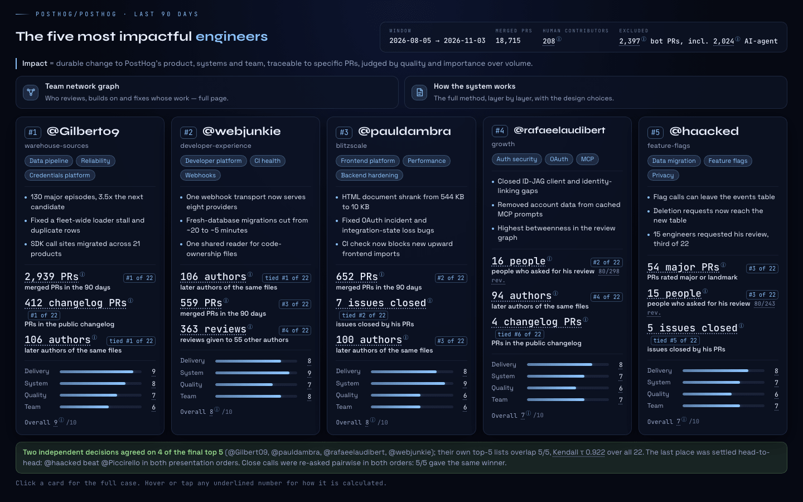
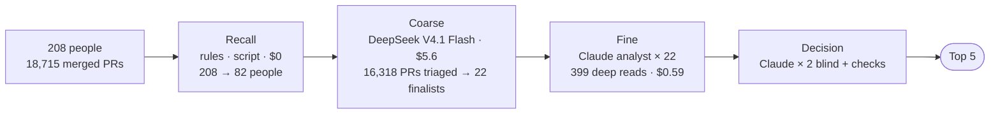
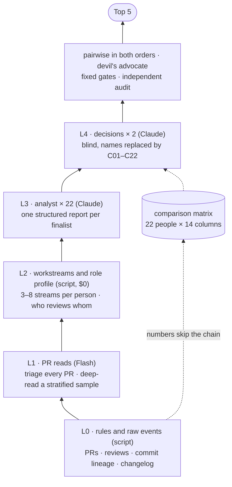
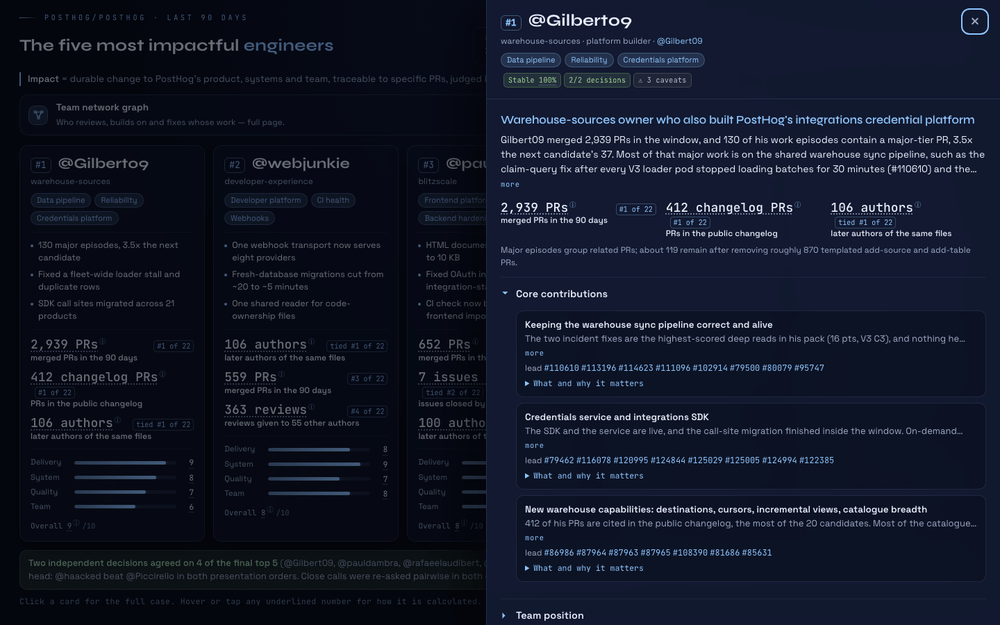
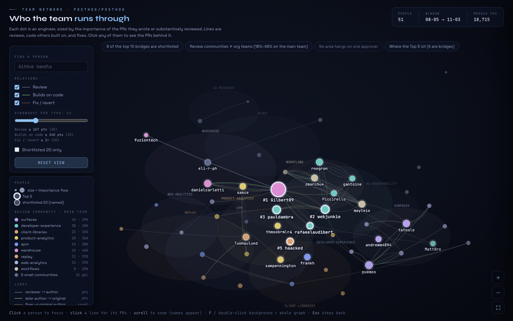
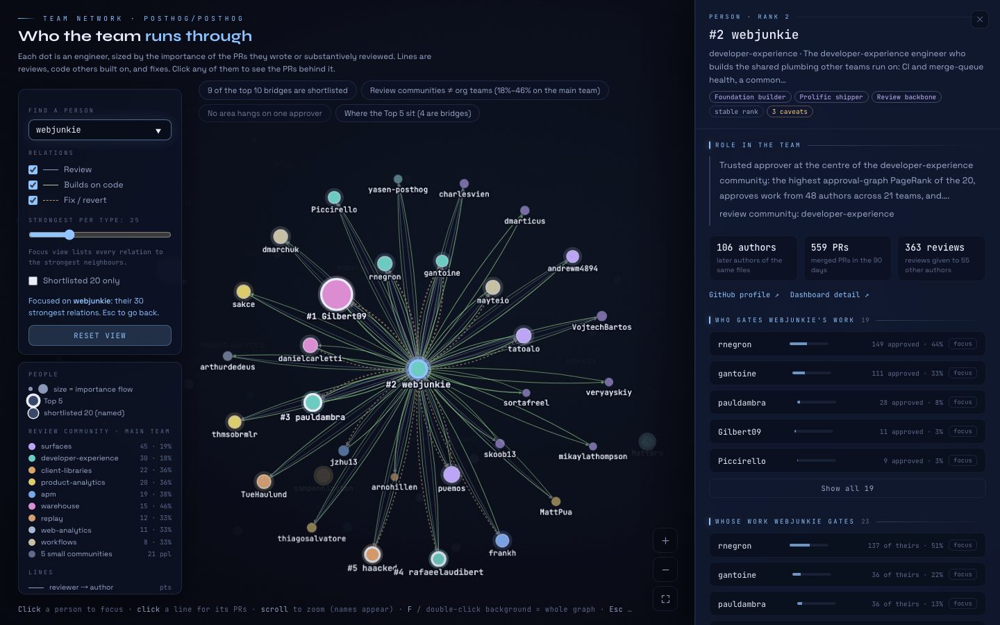
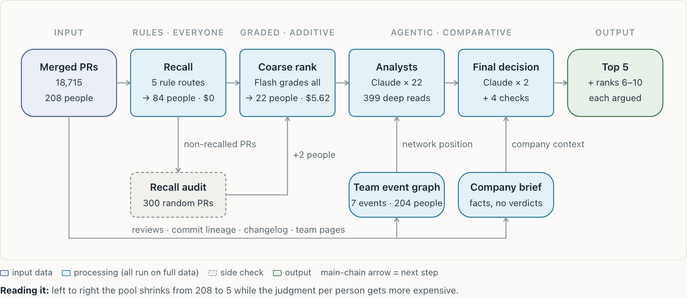
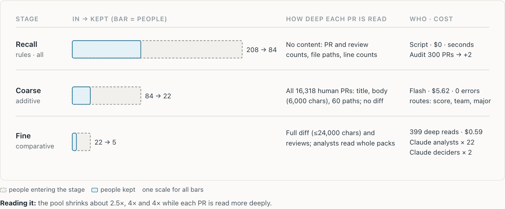

<div align="center">

# PostHog engineering impact

**Who were the five most impactful engineers in [PostHog/posthog](https://github.com/PostHog/posthog) over the last 90 days, and why.**

<sub>Weave take-home · PRs merged 2026-08-05 → 2026-11-03</sub>

[](https://yuanyunchen.github.io/posthog-impact-dashboard/)
[](results/validation.json)
[](results/candidates/)
[](results/validation.json)

### [Dashboard](https://yuanyunchen.github.io/posthog-impact-dashboard/) &nbsp;·&nbsp; [Team network](https://yuanyunchen.github.io/posthog-impact-dashboard/network.html) &nbsp;·&nbsp; [How it works](https://yuanyunchen.github.io/posthog-impact-dashboard/method/explainer-en.html) &nbsp;·&nbsp; [Session log](session/conversation.md)

<a href="https://yuanyunchen.github.io/posthog-impact-dashboard/"></a>

</div>

**Time spent:** 2 h 24 m: 2 h 14 m of interactive work on Nov 3 (17:03–19:17), plus 10 m on Nov 4 for deployment and the session export.

## Top 5

| # | Engineer | Role in one line |
|:-:|---|---|
| 1 | [Gilbert09](https://github.com/Gilbert09) | Warehouse-sources owner who also built PostHog's integrations credential platform |
| 2 | [webjunkie](https://github.com/webjunkie) | Developer-experience engineer who builds shared webhook, CI and ownership plumbing |
| 3 | [pauldambra](https://github.com/pauldambra) | Frontend-platform engineer cutting boot cost and hardening shared Django paths |
| 4 | [rafaeelaudibert](https://github.com/rafaeelaudibert) | Growth-team engineer whose major work centres on OAuth and MCP security |
| 5 | [haacked](https://github.com/haacked) | Feature-flags engineer who led the flag_evaluations storage migration |

The case for each pick (why, key points, caveats, sources) is in [`results/published.json`](results/published.json); the final ranking and its decision trail in [`results/final.json`](results/final.json); each finalist's full analyst report in [`results/candidates/<login>/report.json`](results/candidates/).

## Approach in three ideas

**1. Multi-angle, not one score.**
Four angles (delivery importance, system leverage, engineering quality, team leverage), each backed by script-computed numbers, an agent's reading of the PRs, and what colleagues did with the work. PRs are tiered 1-2-4-8-16 and related PRs grouped, so importance beats volume and splitting work earns nothing.

**2. Relative, whole-team modelling.**
A team event graph over all 18,715 merged PRs records who approves, corrects, requests and fixes whose work; review communities match official teams only 18–46%. The deciders first form a view of PostHog's priorities, then place each person in it, and settle close calls head-to-head in both presentation orders.

**3. A funnel that spends judgment where it matters.**
Rules on all 208 people, a cheap model on all 16,318 human-authored PRs, an agentic analyst for each of 22 finalists, then two blind decisions, head-to-head checks, a devil's-advocate round and an independent audit. Total LLM cost about $8.





## Screenshots

<table>
  <tr>
    <td width="50%"><a href="https://yuanyunchen.github.io/posthog-impact-dashboard/#candidate=Gilbert09"></a><br/><sub><b>Candidate drawer</b>: the full case, core contributions and their lead PRs</sub></td>
    <td width="50%"><a href="https://yuanyunchen.github.io/posthog-impact-dashboard/network.html"></a><br/><sub><b>Team network</b>: review communities, bridges and the top 5's position</sub></td>
  </tr>
  <tr>
    <td width="50%"><a href="https://yuanyunchen.github.io/posthog-impact-dashboard/network.html"></a><br/><sub><b>Focus view</b>: webjunkie's 30 strongest relations, who gates whose work</sub></td>
    <td width="50%"><a href="https://yuanyunchen.github.io/posthog-impact-dashboard/method/explainer-en.html"></a><br/><sub><b>Architecture</b>: one main chain, two side channels</sub></td>
  </tr>
  <tr>
    <td colspan="2" align="center"><a href="https://yuanyunchen.github.io/posthog-impact-dashboard/method/explainer-en.html"></a><br/><sub><b>Funnel</b>: fewer people at each stage, deeper reading of each PR</sub></td>
  </tr>
</table>

## Key numbers

| Stage | In → out | Cost |
|---|---|---|
| [Data](results/validation.json) | 18,715 merged PRs (16,318 human-authored), 208 people; 91/91 days reconciled with GitHub search | $0 |
| [Recall](results/recall_stats.json) | 208 people → 139 eligible → 82 recalled | $0 |
| [Coarse](results/coarse.json) | 16,318 human PRs triaged, 0 errors → 22 shortlisted | $5.6 |
| [Deep read](results/validation.json) | 399 PRs read with diffs and reviews; 1,980 quotes checked, 1.0% failed | $0.59 |
| [Analysts](results/candidates/) | 22 reports, one agent per finalist | session |
| [Decision](results/decision/) | 2 blind rankings: top-5 overlap 5/5, Kendall τ 0.922; 5/5 boundary pairs consistent in both orders | session |

Billed DeepSeek cost across every call, including development runs and the audit round, is **$7.76**; Claude agent sessions are not billed per call. A random miss audit of 300 PRs by people the rules did not recall brought in Piccirello and MattBro, and both won a shortlist seat.

<details>
<summary><b>Method</b></summary>

Impact here means a durable change to PostHog's product, systems or team that can be traced to specific PRs, with importance and quality weighted above volume. The pipeline is a three-stage funnel. **Recall** is rule-based and errs towards keeping people: delivery, team leverage, system paths, changelog entries and critical labels. **Coarse ranking** has a cheap model (DeepSeek V4.1 Flash) sort every human-authored PR into a tier on a 0-1-2-4-8-16 scale, so one major change outweighs many small ones. The shortlist takes the top people by tier-weighted score and team leverage, plus the top authors by major-work episodes, giving 22 people. **Fine ranking** deep-reads a stratified sample of PRs with their diffs and review threads. It also builds a **team event graph** of all 18,715 PRs (approvals, change requests, review requests, reverts, follow-up fixes, later work on the same files). Each shortlisted engineer then goes to an independent analyst agent, which writes a structured report. At every layer, a claim carries the number and the PR or metric key behind it. Two ranking agents read the 22 reports blind, with names replaced by C01–C22, and rank them independently. Disputed boundary pairs are re-judged in both presentation orders, a devil's-advocate pass challenges the top 5, and fixed gates check each pick. **Scores are reference only; the agents decide**, and the reference score R only breaks ties.

The full method, layer by layer, is in the [explainer](https://yuanyunchen.github.io/posthog-impact-dashboard/method/explainer-en.html) ([source](site/method/explainer-en.html)).
</details>

<details>
<summary><b>Independent audit</b></summary>

Round one analysed 20 engineers and picked Gilbert09, webjunkie, pauldambra, Piccirello and haacked. An independent audit then re-checked every input against the raw PR data and found four problems: the shortlist had missed strong engineers (eli-r-ph and MattBro were added), the quality rate's numerator and denominator used different PR sets, the follow-up-fix metric could not see self-repair, and some explanations claimed more than the merged PRs show. The calculations and claims were fixed and all 22 candidates were re-ranked. The top three held, rafaeelaudibert entered at 4th, and Piccirello fell to 6th after losing head-to-head to both haacked and rafaeelaudibert in both orders.

Audit: [`results/audit.md`](results/audit.md) · round one: [`results/round1/`](results/round1/).
</details>

<details>
<summary><b>Limits and data scope</b></summary>

- **Window:** PRs merged 2026-08-05 → 2026-11-03 (91 UTC days). Follow-up fixes and code lineage also look back to 2026-07-06. Work merged after 2026-10-20 has had too little time for quality signals to show.
- **Bot approvals:** 37% of all merged PRs (6,867 of 18,715) and 40% of human-authored PRs were approved only by an AI bot. Review-based signals such as first-pass rate rest on the human-reviewed share, so they are not comparable across people whose AI-only shares differ widely. Post-merge signals (reverts, follow-up fixes by others, self-repair) carry more weight.
- **AI agent PRs:** 2,024 PRs were opened by PostHog's AI agent account. None named a human requester in a form the attribution rule accepts, so none is credited to an individual. PRs that humans opened with AI co-authors count for the human and are flagged as AI-assisted.
- **Review detail caps:** full review threads were fetched per candidate for the deep-read sample plus their top 60 authored and top 80 reviewed PRs (GraphQL quota). The dashboard records each person's coverage.
- **Deep reads are a sample:** about 18 PRs per candidate, stratified by tier; each stratum's mean is extrapolated over the rest of that tier.
- **Network metrics are proxies:** approval-network centrality, later authors of the same files and change-request resolution count graph positions and file edits, not trust, dependency or adoption.
- **Team map:** team membership comes from the GitHub handles people list on their posthog.com team profiles (139 of 243 members list one). Candidates without one get the team that owns their main code area, marked as inferred.
</details>

<details>
<summary><b>How to reproduce</b></summary>

Needs Python ≥ 3.12, `gh` logged in (GraphQL, ~5,000 points/hour), git, and an OpenRouter key in the environment.

```bash
python3 -m venv .venv && .venv/bin/pip install httpx networkx numpy scipy pytest
export OPENROUTER_API_KEY=...            # read from the environment only; never commit it
.venv/bin/python -m pytest -q            # offline tests on fixtures

# 1. data (≈10 min, $0)
python scripts/fetch_prs.py 2026-07-06 2026-11-03   # → data/raw/<day>.json
python -m impact.normalize                          # → data/prs.jsonl
git clone --filter=blob:none --shallow-since=2026-07-01 https://github.com/PostHog/posthog data/posthog
python -m impact.data_extra lineage                 # → data/lineage.json, data/commit_authors.json
python -m impact.data_extra org                     # → data/team_map.json, data/changelog.json from inputs/org/

# 2. scripted stages: recall → coarse → reviews → fine-prep (≈15 min, ≈$6)
IMPACT_OUT=out_full python -m impact.pipeline all
IMPACT_OUT=out_full python -m impact.fine.context   # → out_full/context/company.md
```

The agent steps run in a coding agent (Claude Code was used) at the repo root with `IMPACT_OUT=out_full` set. Each step writes prompts, an agent answers, and the answer is saved as JSON next to the prompt:

1. **Analysts (22 agents, one per candidate).** Print each brief with `python -c "from impact.fine.cards import l3_brief; print(l3_brief('out_full/candidates/<login>'))"` and give it to a fresh agent. The agent explores its data pack with `python -m impact.fine.query <login> …`, writes `report.json` into the pack, and validates it with `python -m impact.contracts report <path>`.
2. **Rankers.** `python -m impact.fine.aggregate prep out_full` writes `decision/primary_prompt.md` and `decision/second_prompt.md`; give each to a separate fresh agent and save the replies as `decision/primary.json` and `decision/second.json`. In round two, the audit corrections in `decision/_audit_addendum.md` were appended by hand to the ranker and devil prompts.
3. **Boundary pairs.** `aggregate pairs out_full` writes `decision/pairwise/*.prompt.md`; save each reply as the same name with `.json`.
4. **Devil's advocate.** `aggregate devil out_full` writes `decision/devil_prompt.md`; save the reply as `decision/devil.json`.
5. **Final.** `aggregate final out_full` writes `final.json`. Then `python -m impact.validation out_full`, `python -m impact.site_data out_full site` and `python -m impact.site_network data/prs.jsonl out_full site` rebuild the dashboard data.
</details>

<details>
<summary><b>Repository layout</b></summary>

| Path | What it holds |
|---|---|
| [`site/`](site/) | The dashboard: static HTML/JS/CSS plus pre-built data files; serve it as the GitHub Pages root |
| [`results/`](results/) | Audit trail of the final run: `published.json` (dashboard text), `final.json`, `decision/` (both rankings, pairwise, devil, audit addendum), `candidates/<login>/report.json` (22), `matrix.json`, `coarse.json`, `recall_stats.json`, `validation.json`, `context/company.md`; `audit.md` (independent audit) and `round1/` (round-one final and decisions) |
| [`impact/`](impact/) | Pipeline code: `recall/`, `coarse/`, `fine/` (deep read, team graph, packs, query tool, aggregation), prompts, `config.py` with every constant |
| [`inputs/org/`](inputs/org/) | posthog.com team profiles and changelog snapshot (2026-11-03) used for team membership and user-facing PRs |
| [`scripts/fetch_prs.py`](scripts/fetch_prs.py) | GitHub GraphQL fetch, one search window per day, checked against the search count |
| [`tests/`](tests/) | Offline pytest suite on fixtures |
| [`docs/`](docs/) | Design spec and implementation plan (Chinese, written during the build); README screenshots in `docs/assets/` |

`data/` (raw PRs, review detail, shallow clone, LLM cache; ≈2.6 GB) and the full `out_full/` working directory are not committed. The source paths printed on the dashboard say `out_full/…`; the committed copies of those files are under `results/`.
</details>
